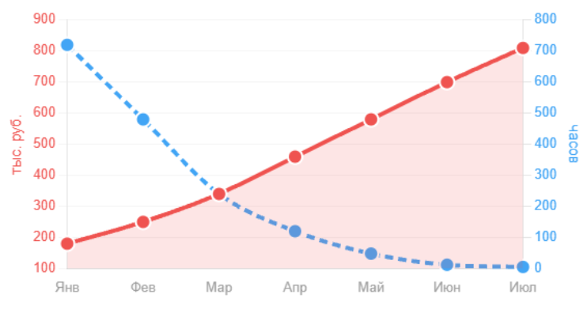

  

  <PageBadge base="7" />
  

    

    
Боль — Elastic пухнет, retention падает

  

  

    

      
TCO вырос в 4.5×, Retention упал до 5 часов

      

        
      

      

        

          
          Стоимость (TCO)
        

        

          
          Время хранения
        

      

    

    

      

        <FAIcon name="server" :size="24" color="#C62828" />
        
18 нод Elastic + 2 SRE + DevOps на тушении пожаров TCO 810к руб./мес · Retention 5 часов

      

      

        <FAIcon name="fire" :size="24" color="#C62828" />
        
FluentD терял логи при пиковых нагрузках

      

    

  

<!-- notes: Мы платили премиум за инфраструктуру, которая не выполняла свою базовую функцию — хранить логи дольше 5 часов. За полгода стоимость EFK выросла с 180 до 810 тысяч рублей в месяц, а retention наоборот падал: с 30 дней до 5 часов. Любой инцидент, расследование которого требует логов старше пяти часов, превращался в рулетку. Параллельно два SRE и привлекаемые DevOps постоянно тушили пожары. -->
