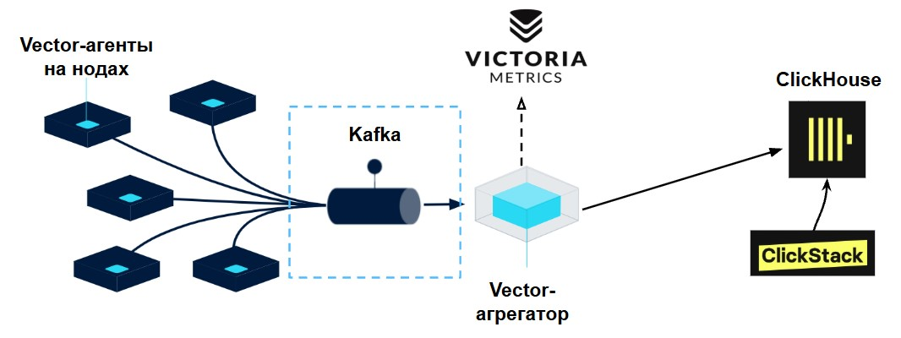

  

  <PageBadge base="13" />
  

    

    
Архитектура сбора логов

  

  

    
  

<!-- notes: Kafka здесь не для моды, а для гарантии доставки. Vector Agent стоит на каждой ноде и делает грязную работу: читает файлы, парсит, добавляет metadata. Vector Aggregator делает тяжёлую трансформацию через VRL и решает TTL. ClickHouse хранит и сжимает, давая сжатие 10–20x по сравнению с Elastic. Три ЦОД означают, что при отказе одного дата-центра логи продолжают писаться через два других. Конкретные цифры по доставке — на слайде эффектов ближе к концу. -->
