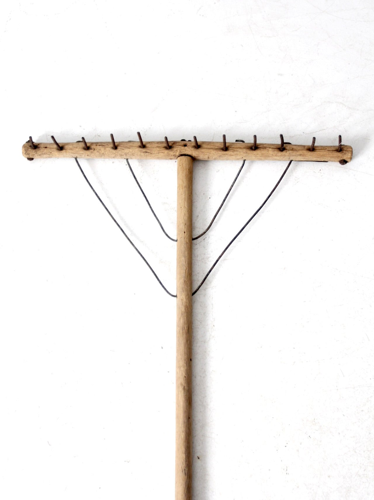

  

  

  

  
CASE 4

  <PageBadge base="41" />
  <header style="padding:40px 70px 16px 70px;display:flex;align-items:center;gap:22px;position:relative;z-index:10;">
    

    

      
CASE 4 · ВСТУПЛЕНИЕ

      <h1 style="font-family:'Montserrat',sans-serif;font-weight:900;font-size:38px;color:#212121;line-height:1.1;margin:0;">Что может пойти не так в пятницу...</h1>
    

  </header>
  <main style="flex:1;padding:20px 70px 40px 70px;display:flex;flex-direction:column;align-items:center;justify-content:center;position:relative;z-index:10;">
    

      
    

    
Грабли, на которые мы наступили в пятницу

  </main>

<!-- notes: Перед следующим кейсом — небольшая пауза. Этот слайд — вступление. Пятница, конец недели, и мы решили, что всё хорошо. Как выяснилось — зря. Дальше — история одного пятничного паника. -->
