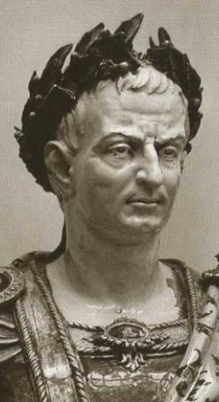

  

  

  

  
CASE 4

  <PageBadge base="48" />
  <header style="padding:40px 70px 16px 70px;display:flex;align-items:center;gap:22px;position:relative;z-index:10;">
    

    

      
CASE 4 · ПРИЧИНА

      <h1 style="font-family:'Montserrat',sans-serif;font-weight:900;font-size:32px;color:#212121;line-height:1.15;margin:0;">Правление Императора Тиберия, 24 год нашей эры</h1>
    

  </header>
  <main style="flex:1;padding:20px 70px 30px 70px;display:flex;flex-direction:column;align-items:center;justify-content:center;position:relative;z-index:10;">
    

      
    

    
Бюст императора Тиберия, правившего с 14 по 37 год н. э.

  </main>

<!-- notes: Причина паники — в дате. VRL-функция to_unix_timestamp интерпретировала timestamp как 24 год нашей эры — время правления императора Тиберия. Прежде чем показать код — пусть зал догадается, причём здесь римский император. -->
