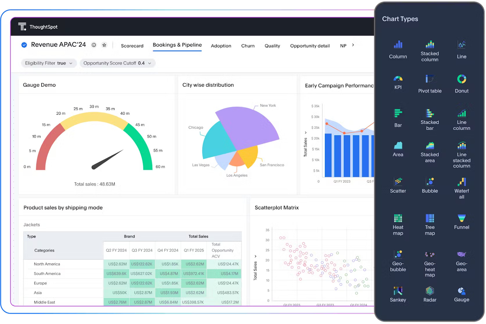

  

    
    

    

    

      
OTel Logs Data Model

      
Поиск логов через ClickStack MCP

    

  

  

    

      

      

        <h1 style="font-family:'Montserrat',sans-serif;font-weight:900;font-size:36px;color:#212121;line-height:1.15;margin:0;">AI-Ready Observability</h1>
        
ClickStack MCP

      

    

    

      <FAIcon name="info-circle" :size="22" color="#7E57C2" />
      
Поиск логов стал возможен за счёт стандартизации OTel + ClickStack

    

    

      

        

          <FAIcon name="broom" :size="24" color="#C62828" />
          <h4>Было: неструктурированный хаос</h4>
        

        
Каждый сервис пишет логи в своём формате.

      

      

        

          <FAIcon name="project-diagram" :size="24" color="#1565C0" />
          <h4>Стало: OTel Logs Data Model</h4>
        

        
Единая схема для 200+ сервисов: Body, Attributes, Resource.

      

      

        

          <FAIcon name="robot" :size="24" color="#7E57C2" />
          <h4>ClickStack MCP</h4>
        

        
LLM строит SQL к полям Attributes. Time-to-insight: секунды вместо минут grep.

      

    

  

  <PageBadge base="46" style="top:22px;right:30px;" />

<!-- notes: AI-Ready Observability — официальный MCP-сервер. Поиск логов стал возможен за счёт стандартизации OTel и применения ClickStack как средства просмотра логов. ClickStack знает схему OTel и строит SQL-запросы по полям Attributes и Resource. MCP-ассистент строит запрос вида SELECT body FROM logs WHERE resource.service_name = 'X'. Не угадывает поля, потому что схема формально описана. -->
